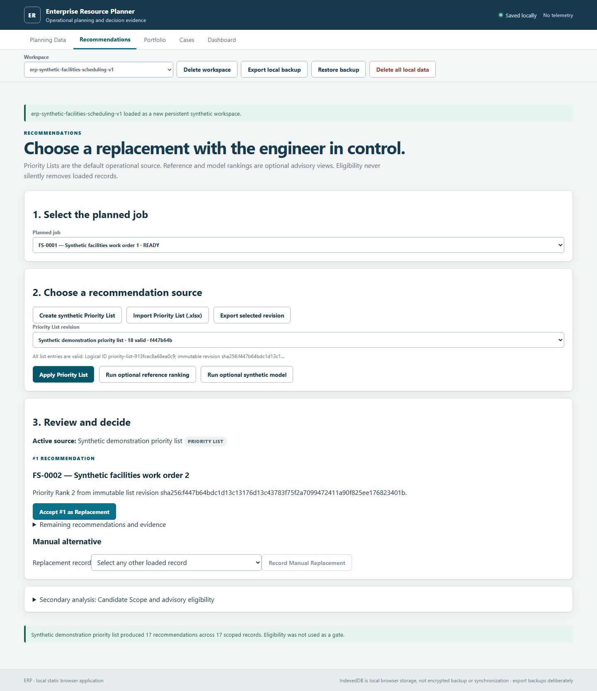

# Enterprise Resource Planner

**Plan job replacements and work portfolios from Excel.**

Enterprise Resource Planner (ERP) is a local-first web application for maintenance and operations planning. Import a schedule, inspect and edit it in a spreadsheet-style workbench, rank possible replacements, and save the decisions you make.

Your priority lists come first. Weighted scoring and an example model can provide a second view, but the final choice stays with the user.

Despite the name, ERP is not a finance or accounting suite.

**[Open the live application](https://davidoffichw.github.io/enterprise-resource-planner/)**



## Quick start

You will need Node.js 24.15 or later and npm 11 or later to build or run ERP locally.

```powershell
npm ci
npm run dev
```

Open the local URL printed by Vite.

To verify, build, and preview the production version:

```powershell
npm run verify
npm run preview
```

The static build is written to `dist/`. Once built, ERP does not need Node.js, Python, or a backend to run.

## Try a replacement decision

1. Open **Facilities example** from **Planning Data**.
2. Go to **Recommendations** and choose the job to replace.
3. Open **Priority lists** and create **Example priorities**.
4. Select **Example priorities** under **Rank by**, then choose **Apply ranking**.
5. Pick a replacement and choose **Use this replacement**.
6. Open **History** to review the saved decision.

The built-in maintenance and facilities plans contain fictional data, so you can explore ERP without importing your own files.

## Features

- **Excel workbench:** Import and export `.xlsx` files, including multi-sheet workbooks. Edit cells, filter rows, sort columns, and undo changes without losing the original worksheet structure.
- **Semantic mapping:** Map source columns to planning roles while retaining original labels, values, extra columns, and provenance.
- **Priority lists:** Import and reuse job priorities while preserving exact numeric ranks and earlier list versions. Missing ranks remain unranked.
- **Replacement planning:** Compare ranked candidates, use optional scoring methods, or choose any loaded replacement yourself. Incomplete records remain available with visible warnings.
- **Portfolio planning:** Select work around budget and resource limits. The optimizer uses exact enumeration for up to 20 candidates and a deterministic heuristic for larger sets.
- **Decision history:** Save replacements, revisit earlier decisions, compare scenarios, and export decision records.
- **Local storage:** Keep multiple plans in your browser, export backups, and restore them later.
- **Offline support:** After the hosted application has loaded and cached its assets, it can run without a network connection.
- **Dark and light themes:** Use a compact interface designed for dense tables and planning data.

## Architecture

ERP uses TypeScript, React, Vite, AG Grid Community, `read-excel-file`, `write-excel-file`, and `fflate`.

- `src/contracts/` defines shared data structures and evidence contracts.
- `src/core/` contains deterministic, framework-independent planning logic.
- `src/web/` provides React components, spreadsheet adapters, and browser persistence.
- `public/` contains the manifest, icons, and offline service worker.

Keeping planning logic outside React makes the decision rules independently testable and avoids making UI state the source of domain truth. Exact dependency versions are locked in `package-lock.json`; third-party licenses are summarized in [THIRD_PARTY_NOTICES.md](THIRD_PARTY_NOTICES.md).

## Computer science concepts explored

ERP is also an educational engineering project inspired by concepts taught in software engineering, data systems, operations research, security, and machine learning courses and training materials. It provides a practical setting for experimenting with several important ideas:

- **Content-addressed snapshots:** Canonical serialization and SHA-256 digests distinguish a logical dataset from a particular immutable content revision.
- **Provenance-aware data pipelines:** Raw spreadsheet values, normalized values, user edits, external edits, mappings, and generated evidence remain distinguishable throughout import and export.
- **Append-only evidence and idempotency:** Versioned decisions and Priority Lists preserve history, while stable decision identities prevent accidental duplicate submissions.
- **Constraint and ranking separation:** Eligibility and data-quality assessments do not silently become ranking scores, and advisory checks remain distinct from binding constraints.
- **Bounded combinatorial optimization:** Small portfolios use exact subset enumeration; larger populations use a deterministic heuristic with an explicit non-optimality qualification.
- **Offline-first consistency:** IndexedDB transactions, portable backups, service-worker cache scopes, and atomic import boundaries support local operation without a backend.
- **Untrusted document processing:** Workbook size budgets, archive path checks, formula handling, schema validation, and safe export rules constrain the OOXML input boundary.
- **Schema evolution and referential integrity:** Versioned envelopes and context-bound identifiers keep datasets, mappings, rankings, scopes, and saved decisions connected to the evidence that produced them.

These implementations are intended for learning and experimentation as well as practical planning. They should not be treated as reference implementations for every production environment.

## Data and privacy

ERP processes spreadsheets in the browser. It has no account system, backend database, telemetry, remote fonts, CDN dependency, or remote inference service.

Plans and decisions are stored locally using IndexedDB. That storage belongs to the current browser profile, so export a backup before clearing site data or switching devices. Local storage is not encrypted or automatically synchronized.

## Deployment

ERP can be served from a suitable static host over HTTP or HTTPS. Opening the built files directly with `file://` is not supported.

For GitHub Pages, the repository includes a manual deployment workflow in `.github/workflows/deploy-pages.yml`. The build accepts a repository subpath through `ERP_BASE_PATH`.

## Background

ERP began as an independently developed educational engineering project inspired by courses and training materials in computer science, data systems, operations research, security, and machine learning. Its purpose is to turn critical concepts into working software and demonstrate practical understanding of data integrity, reproducibility, optimization, offline architecture, and human-controlled decision support.

Version 0.1.0 already connects spreadsheet ingestion, semantic mapping, provenance, deterministic ranking, constrained portfolio selection, immutable decision evidence, browser persistence, backup and recovery, and offline delivery in one coherent application. The example model intentionally demonstrates a reproducible ranking pipeline without presenting educational coefficients as real-world predictions.

A path toward elite-level product maturity is concrete: broader workbook reconciliation, worker-based processing for measured high-volume workloads, pluggable mathematical solvers, qualified domain models, encrypted and synchronized team workspaces, richer audit collaboration, and formal accessibility, security, and cross-device qualification. These are deliberate extensions of the existing architecture, not substitutes for the working planning workflow delivered here.

ERP remains a decision-support tool. Operational adoption should use organization-specific validation, policies, data controls, and professional judgment. Browser-local work should be backed up before site data is cleared or work moves to another device.

Release notes are available in [CHANGELOG.md](CHANGELOG.md).

## License

ERP is available under the [MIT License](LICENSE).
